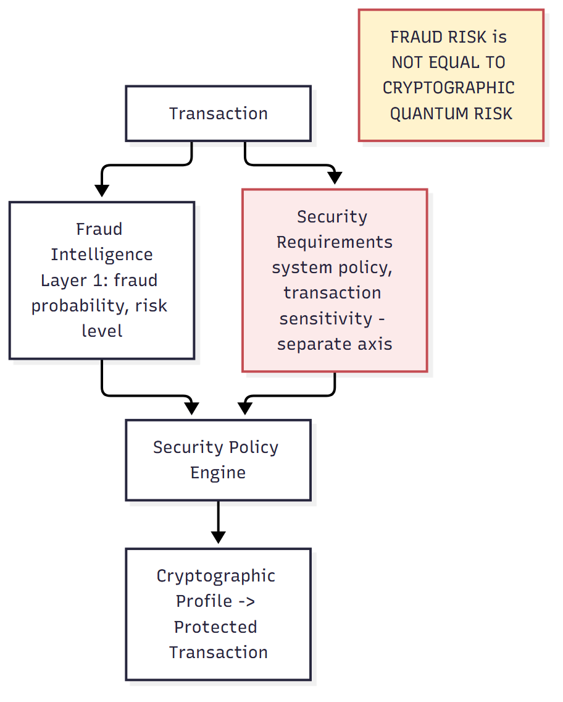
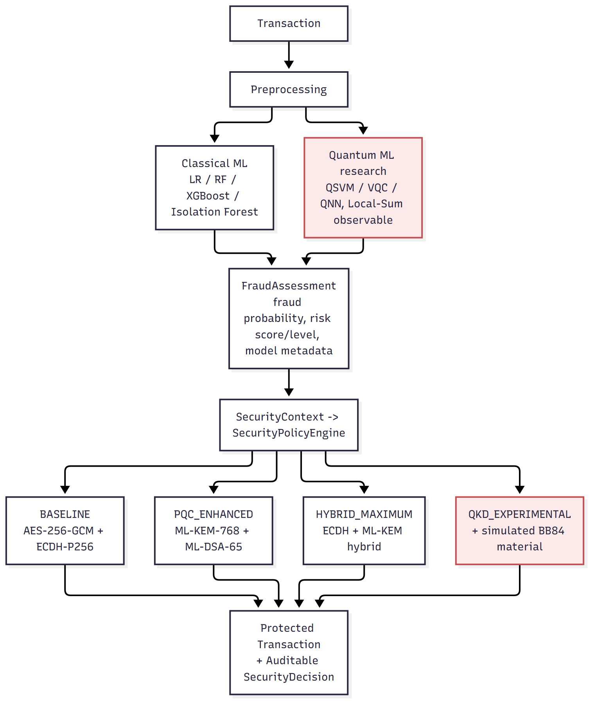
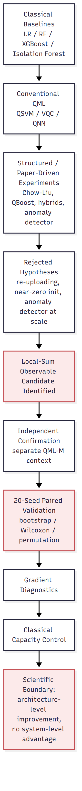
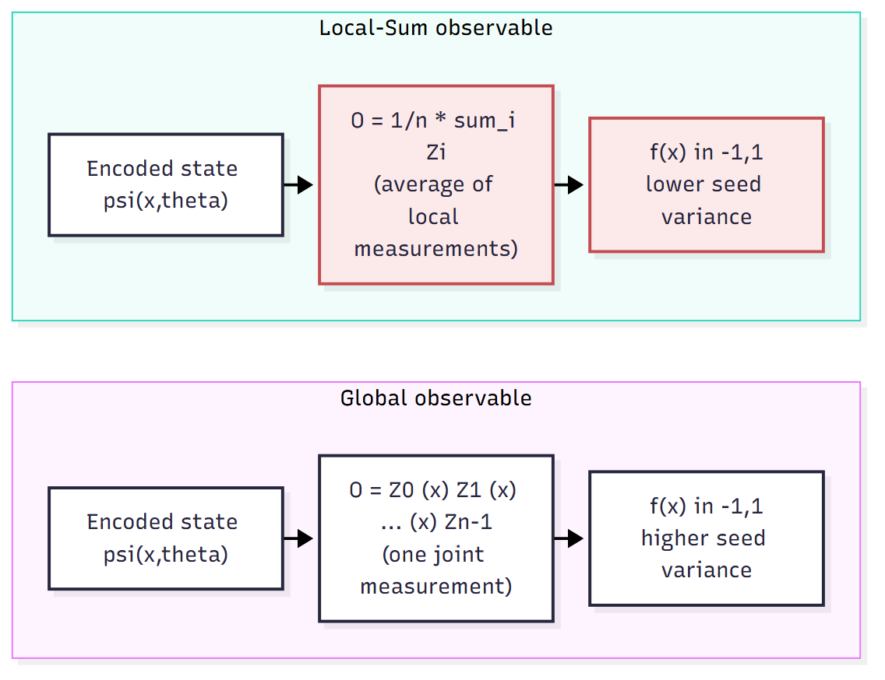
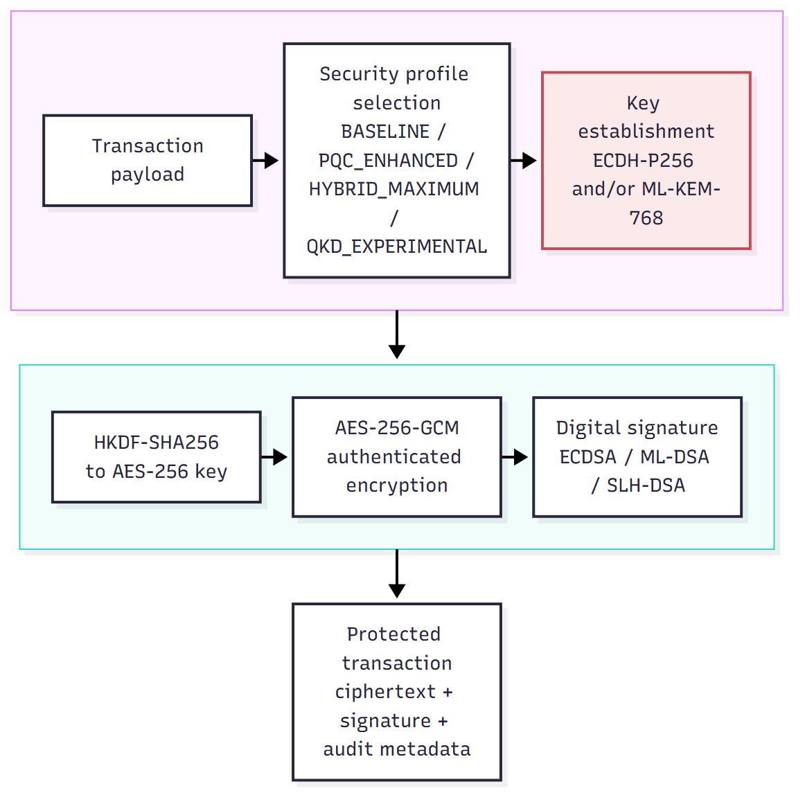
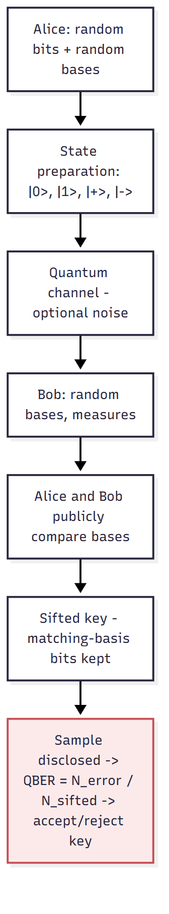
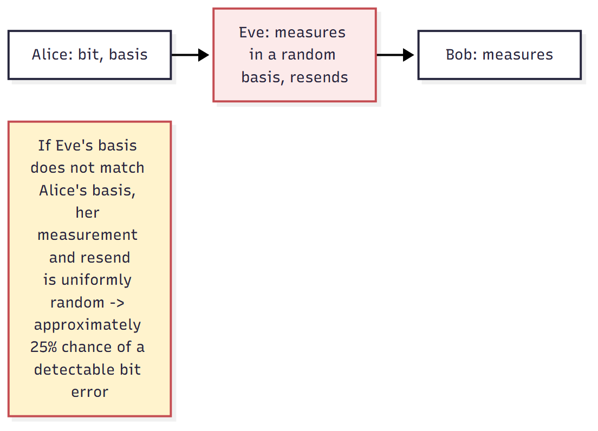

# Quantum-Secure Fraud Detection System (QSFD)

QSFD is an experimental financial-security platform investigating **where quantum machine learning, post-quantum
cryptography, and simulated quantum key distribution provide measurable value within an integrated fraud-aware
architecture** — and where they do not. Rather than assuming quantum methods must outperform classical
alternatives, the project uses controlled experiments, strong classical controls, and pre-specified protocols to
identify both benefits and boundaries.

> **This project does not claim quantum supremacy.** It provides: (1) a statistically supported QML
> architecture-level improvement, (2) rigorous evidence establishing the *boundary* of that improvement, (3) a
> real post-quantum cryptography implementation and benchmark, (4) a controlled BB84 simulation, (5) a
> cost-constrained Layer 1 → Layer 2 integration experiment, and (6) reproducible positive *and* negative results.

## Central Research Question

*Where do quantum and post-quantum techniques provide measurable utility, where do they fail to provide
additional utility, and what practical trade-offs emerge when they are integrated into a fraud-aware financial
security architecture?*

This decomposes into three investigated dimensions:

| Dimension | Question |
|---|---|
| **A. Quantum machine learning** | Can quantum model design improve the stability and predictive behavior of a variational quantum fraud detector? |
| **B. Quantum utility boundary** | Does that improvement translate into superiority or incremental utility over strong classical fraud-detection methods? |
| **C. Quantum-secure systems** | How can fraud intelligence, post-quantum cryptography, and simulated QKD coexist in an integrated architecture, and what trade-offs result? |

A conceptual insight emerges from dimension C that shapes the whole architecture:

> **FRAUD RISK ≠ CRYPTOGRAPHIC QUANTUM RISK.** *"How suspicious is this transaction?"* (Layer 1) and *"what
> cryptographic protection should this transaction receive?"* (Layer 2) are related but not equivalent questions.
> A low-fraud-probability transaction is not thereby exempt from post-quantum protection; a high-fraud-probability
> transaction is not automatically more vulnerable to Shor's algorithm.



## System Architecture



**Every security profile, including BASELINE, uses full AES-256-GCM authenticated encryption plus a real
key-establishment algorithm.** Fraud risk controls only *additional* protection layered on top — it never weakens
the baseline.

## Research Questions

| # | Question | Answer | Evidence |
|---|---|---|---|
| RQ1 | How do strong classical and quantum models compare for highly imbalanced fraud detection? | Classical (XGBoost) leads on both production and controlled benchmarks | `docs/research/layer1/QUANTUM_GATE_RESULT.md` |
| RQ2 | Can observable locality materially improve a variational quantum fraud classifier without increasing quantum resources? | **Yes — statistically supported** | 20-seed paired experiment, below |
| RQ3 | Does the improved QML representation provide statistically verified incremental utility beyond strong classical controls? | **No — not verified** | Classical capacity control, below |
| RQ4 | What overhead arises from introducing standardized post-quantum primitives into the transaction-security layer? | Substantial and strongly implementation-dependent: compiled `pqcrypto` is 3.4-62x faster than the pure-Python reference; SLH-DSA-128s signing stays ~1.3 s even compiled (see Final Layer 2 Results) | `docs/research/layer2/LAYER2_RESULTS.md` |
| RQ5 | Does the implemented BB84 simulator reproduce expected eavesdropping/noise behavior? | **Yes, under stated simulation conditions** (30/30 trials) | `results/layer2/bb84_summary.csv` |
| RQ6 | Can Layer 1 risk intelligence improve Layer 2 security orchestration under a pre-specified operational cost budget? | **Not under the tested configurations** | `docs/research/integration/LAYER1_LAYER2_INTEGRATION_EXPERIMENT_RESULTS.md` |
| RQ7 | What architectural lesson emerges from integrating fraud risk, QML, PQC, and simulated QKD? | Fraud risk and cryptographic-quantum-threat posture must be modeled as separate axes, not one derived from the other | See diagram above |

## Layer 1 — Fraud Detection

### The Experimental Progression



**Classical baselines** established first (Logistic Regression, Random Forest, XGBoost — production, Isolation
Forest). **Conventional QML** (QSVM, VQC, QNN) evaluated next on a controlled subset — none beat the classical
baselines. Rather than stopping there, the project asked whether the limitation was partly *architectural*, and
investigated structured topologies, quantum kernels, anomaly detection, data re-uploading, and initialization
strategies — most of these hypotheses were **rejected under stronger validation** (see
[Negative Results](#negative-results)). One candidate survived: changing the QNN's *measurement observable*.

### The Local-Sum Observable Finding



Holding circuit resources constant, changing the measurement from a **global** observable (one joint measurement
across all qubits) to a **local-sum** observable (the average of per-qubit local measurements) produced a
statistically supported improvement in fraud-ranking performance, validated across 20 paired random seeds:

| | Global QNN | Local-Sum QNN |
|---|---:|---:|
| Mean PR-AUC (20 seeds) | 0.8077 | **0.8612** |
| Std | 0.073 | 0.051 |

**Mean paired delta: +0.0536** · **Bootstrap 95% CI: [+0.0149, +0.0913]** (excludes zero) · **Wilcoxon p = 0.0086**
· **Permutation p = 0.0072** · **Local-Sum won 13/20 seeds**, not driven by any single outlier.

Gradient diagnostics show the Local-Sum observable's gradient norm is smaller *and* less variable across seeds at
every training checkpoint than the Global observable's — **consistent with improved optimization stability**,
not with larger/healthier gradients or proof of barren-plateau elimination. This is a conservative, evidence-scoped
claim, not a causal one.

### The Classical Capacity Control — Establishing the Boundary

The Local-Sum result answers *"does quantum model design matter?"* — yes. It does not by itself answer the harder
question: *"does the improved quantum representation provide information an equivalent classical nonlinear
representation cannot?"*

| Architecture | PR-AUC |
|---|---:|
| XGBoost alone | 0.9613 |
| XGBoost + Local-Sum QNN | 0.9665 |
| XGBoost + matched classical nonlinear control | **0.9671** |

The classical control's point estimate is *higher* than the quantum-augmented ensemble's, and neither delta
excludes zero on a paired bootstrap. **Answer: not verified.** This is the boundary of the Local-Sum finding, and
it is reported with the same weight as the positive result above.

### What Layer 1 Establishes / Does Not Establish

| Establishes | Does Not Establish |
|---|---|
| Local-Sum observable significantly improves the matched Global-observable QNN (statistically supported) | Quantum beats XGBoost |
| The improvement is consistent with reduced optimization variance | Barren-plateau elimination (not proven) |
| Quantum model *design* materially affects fraud-ranking performance | System-level or incremental quantum predictive advantage |

## Layer 2 — Quantum-Secure Financial Security

QML addresses *prediction*; PQC addresses *cryptographic resilience against future quantum-capable adversaries*
— a different problem entirely. Layer 2 implements and benchmarks all three security tracks:

| Track | Algorithms | Purpose |
|---|---|---|
| Classical cryptography | AES-256-GCM, RSA-3072, ECC/P-256 | Symmetric payload protection + classical key establishment/signatures |
| Post-quantum cryptography | ML-KEM-768, ML-DSA-65, SLH-DSA-SHA2-128s (standardized descendants of CRYSTALS-Kyber, CRYSTALS-Dilithium, SPHINCS+) | Quantum-resistant key establishment + signatures |
| Simulated QKD | BB84 (software simulation) | Information-theoretic eavesdropper detection, **not** physical key distribution |

### Cryptographic Protection Flow



Post-quantum key/signature material is substantially larger than classical equivalents (ML-DSA-65's signature is
~47× ECDSA's; SLH-DSA's is ~112×), and signing latency varies by algorithm — ML-DSA's rejection-sampling
construction gives it genuinely high variance (86–1494ms across 30 runs), while SLH-DSA-SHA2-128s required
~15 seconds per signature **in this project's pure-Python implementation**. The project evaluates both a reference pure-Python backend and a compiled optimized backend (`pqcrypto`), so
implementation overhead can be separated from primitive-level cost (see *Final Layer 2 Results* below; the ~15 s
SLH-DSA figure is preserved as reference-implementation history and is not reproduced by the controlled re-measurement).
Native `liboqs` was attempted and could not be built (no CMake/MSVC); **no liboqs measurements exist**. Full benchmarks:
[`LAYER2_FINAL_RESULTS.md`](docs/research/layer2/LAYER2_FINAL_RESULTS.md), [`LAYER2_RESULTS.md`](docs/research/layer2/LAYER2_RESULTS.md),
[`LAYER2_LIMITATIONS.md`](docs/research/layer2/LAYER2_LIMITATIONS.md).

### BB84 Simulation




**This is a software simulation, not physical QKD, quantum hardware, or production quantum communication.** Under
30 trials per condition at a 2000-bit raw key length: measured QBER tracked injected channel noise closely
(1%→0.89%, 5%→4.79%, 10%→9.47%), and an intercept-resend eavesdropper was **detected in 30/30 trials** at the
stated 11% acceptance threshold — a result valid under exactly these stated conditions, not a universal guarantee.

An independent, circuit-level BB84 implementation was additionally built with Qiskit + Qiskit Aer
(`src/security/qkd/bb84_qiskit.py`), preparing and measuring explicit single-qubit states rather than sampling
protocol-level probabilities. Run across the same six conditions (30 trials each, 200-bit raw keys), it agreed
closely with the protocol-level simulator (largest gap 0.62 percentage points) and detected the intercept-resend
eavesdropper in 30/30 trials at the same threshold — see
[`results/layer2/bb84_cross_implementation_comparison.csv`](results/layer2/bb84_cross_implementation_comparison.csv).
This is cross-implementation validation of simulated protocol logic; **it does not make BB84 a physical QKD
demonstration** — no photon is transmitted and no physical no-cloning property is exercised, on a simulator or on
real quantum hardware.

<!-- FINAL-RESULTS-START -->
## Final Layer 2 Results (generated from `results/final/final_results.json`)

| Area | Result (source artifact) |
|---|---|
| PQC backends | Reference Python vs. compiled `pqcrypto` 1.0.0; ML-KEM-768 keygen/encaps/decaps speedups 51x / 57x / 61x; ML-DSA-65 sign 4.8x, verify 58x (`results/layer2/pqc_backend_comparison.csv`) |
| SLH-DSA-SHA2-128s sign | reference 4.33 s (n=3) vs. pqcrypto 1.27 s: 3.4x; earlier ~15 s figure preserved as reference-implementation history |
| End-to-end (median) | classical 0.30 ms; reference PQC 72.8 ms; optimized PQC 10.2 ms; hybrid 10.5 ms |
| BB84 software | protocol vs. Qiskit MAE 0.0028, max gap 0.0065; intercept-resend QBER 0.2508 (protocol, 2000 bits) / 0.2438 (Qiskit, 500 bits) |
| IBM hardware (`ibm_marrakesh`, 5 jobs) | no-Eve QBER best/typical/worse qubit 0.0048 / 0.0094 / 0.0446; intercept-resend model clearly separable; Grover pooled success 0.9460 |
| Tests | 269 passed / 0 failed / 0 skipped |

Full tables: [`docs/research/layer2/LAYER2_FINAL_RESULTS.md`](docs/research/layer2/LAYER2_FINAL_RESULTS.md). BB84 is software-simulated at protocol and circuit level; IBM hardware runs validate selected circuits and are **not** physical QKD.
<!-- FINAL-RESULTS-END -->

## Layer 1 → Layer 2 Integration

The initial intuitive architecture might suggest *higher fraud risk → stronger quantum security*. A pre-specified
experiment (protocol committed **before** results were seen:
[`docs/protocols/LAYER2_INTEGRATION_PROTOCOL.md`](docs/protocols/LAYER2_INTEGRATION_PROTOCOL.md)) tested this
directly across four routing policies, on the production test fold (n=55,133):

| Policy | Fraud-Weighted Coverage | Benign Escalation Rate |
|---|---:|---:|
| Categorical (risk-level) | 74.32% | 0.01% |
| Continuous (probability) | 74.32% (identical — honest null result) | 0.01% |
| + Anomaly-assisted | 74.32% (no gain) | 0.05% (5× cost) |
| + Quantum-assisted (separate sample) | +1.33pp (1 extra fraud caught) | **16× cost increase** |

**Neither anomaly-assisted nor quantum-assisted routing clears the pre-specified cost budget.** This is a valid,
important systems result: *adding more sophisticated risk signals does not automatically improve security
orchestration* — rejecting a signal that costs more than it's worth is the correct engineering decision, and the
pre-specified protocol is what makes this conclusion credible rather than post-hoc.

## Negative Results

Reported with the same rigor as positive findings — see
[`reports/materials/NEGATIVE_RESULTS.md`](reports/materials/NEGATIVE_RESULTS.md) for the full list:

- No quantum model beats controlled classical baselines standalone.
- Chow-Liu structural benefit is qubit-count-dependent against a matched-sparsity control.
- Neither QBoost solver beats classical boosting.
- No hybrid classical-quantum fusion beats XGBoost alone.
- The quantum anomaly detector's promising small-scale result **reversed** at larger, independent scale.
- Data re-uploading and near-zero initialization did not improve on existing baselines.
- Local-Sum QNN does not beat XGBoost, and does not beat a matched classical capacity control.
- Categorical and continuous routing behave identically on this dataset; anomaly/quantum-assisted routing fail
  their pre-specified cost budgets.

## Scientifically Meaningful Contributions

| Contribution | Evidence | Establishes | Does Not Establish |
|---|---|---|---|
| 1. Empirical QML | 20 paired seeds, bootstrap/Wilcoxon/permutation | Observable-locality design improves matched QNN | — |
| 2. QML boundary | Classical capacity control | Improved QML ≠ quantum predictive advantage | Quantum superiority over XGBoost |
| 3. Research methodology | Pre-specified protocols, multi-seed, bootstrap, negative-result preservation throughout | A disciplined framework resistant to overclaiming | — |
| 4. PQC system evaluation | Real, benchmarked ML-KEM/ML-DSA/SLH-DSA implementation; native `liboqs` backend attempted | Integration feasibility + real reference-implementation cost | Universal algorithm performance (native backend unavailable in this environment) |
| 5. QKD simulation + cross-validation | 180 protocol-simulator BB84 trials + 180 independent Qiskit circuit-level trials across 6 matched conditions | Expected eavesdropping/noise behavior reproduced by two independent implementations (agreement within 0.62 pp) | Physical QKD security |
| 6. Integrated systems insight | Pre-specified routing ablation | Fraud risk and cryptographic risk must be modeled separately | Risk-adaptive security is universally ineffective |

Not claimed as "first" — see [`reports/materials/LITERATURE_MATRIX.csv`](reports/materials/LITERATURE_MATRIX.csv)
for what prior work already established. The contribution is methodological rigor and integration, not priority
of invention.

## Limitations

- No web dashboard or API layer exists — this is a research codebase (CLI + notebooks + tests), not a deployed
  system. See [`docs/project/PROJECT_REQUIREMENTS_TRACEABILITY.md`](docs/project/PROJECT_REQUIREMENTS_TRACEABILITY.md).
- Post-quantum benchmarks compare a pure-Python reference with the compiled `pqcrypto` package (not native liboqs, which could not be
  built here); absolute latencies are machine- and build-specific.
- IBM Quantum hardware runs validate selected circuits only (single backend, five jobs within one calibration window); they are not
  physical QKD and the full fraud classifier was not run on hardware. Shor's algorithm is not implemented.
- BB84 is a software simulation with no physical channel; a second, independent Qiskit circuit-level
  implementation adds a simple bit-flip channel noise model and cross-validates the original simulator, but
  neither implementation involves a physical channel or hardware.
- No concurrency/load testing exists.
- The integration experiment's null/negative findings were measured on one dataset and threshold configuration.
- Layer 3 (attack simulation) is not implemented.

Full list: [`reports/materials/LIMITATIONS.md`](reports/materials/LIMITATIONS.md),
[`reports/materials/THREATS_TO_VALIDITY.md`](reports/materials/THREATS_TO_VALIDITY.md).

## Repository Structure

```
src/
  classical_ml/       Classical fraud models (LR/RF/XGBoost/Isolation Forest)
  qml/                 Baseline quantum ML (QSVM/VQC/QNN)
  qml_experimental/    Research layer (Chow-Liu, QBoost, hybrids, observable studies)
  fraud_engine/        Production inference engine + FraudAssessment contract
  security/            Layer 2: classical/, pqc/, qkd/, policy/, integration/, benchmarking/
  data/                Dataset loading, preprocessing, leakage validation
tests/                 228 tests (195 Layer 1 + 33 Layer 2/integration)
scripts/
  research/            Historical Layer 1 experiment scripts
  security/            Layer 2 benchmark scripts
  integration/         Layer 1->Layer 2 policy experiment scripts
  notebooks/           Notebook builder/executor scripts, conceptual diagram generator
  reports/             Final report generator
config/                YAML configuration (datasets, classical, qml, risk policy)
models/                Trained model artifacts (classical + QML)
reports/               Layer 1 evaluation reports, QML experimental results, reports/materials/ (final-report source)
results/               layer1/, layer2/, integration/ -- every experiment's CSV/JSON/NPZ artifacts
docs/                  project/ (traceability), protocols/ (locked splits, pre-specified protocols), research/ (all findings)
artifacts/figures/     Notebook and report figures, organized by layer + diagrams/ (Mermaid-rendered)
artifacts/diagrams_src/  Mermaid (.mmd) source for every conceptual/architecture diagram
research/              ONLY the two final Jupyter notebooks
```

## Installation

```bash
python -m pip install -r requirements.txt
```

## Running Tests

```bash
python -m pytest -q
```

228 tests, 0 failures at time of writing.

## Research Notebooks

```bash
python scripts/notebooks/build_notebook_1.py && python scripts/notebooks/execute_notebooks.py research/01_Layer1_Fraud_Detection_Research.ipynb
python scripts/notebooks/build_notebook_2.py && python scripts/notebooks/execute_notebooks.py research/02_Layer2_Quantum_Secure_Cryptography_Research.ipynb
```

Both load real, previously-computed artifacts (never retrain expensive models inline) and run in well under a
minute each. Diagrams are Mermaid (`.mmd` source in `artifacts/diagrams_src/`, rendered via
`scripts/notebooks/make_conceptual_diagrams.py`, which requires Node.js/`npx`).

## Reproducibility

- Global seed 42, propagated through Python/NumPy/scikit-learn/XGBoost/Qiskit RNGs.
- Locked quantum research subset: [`docs/protocols/locked_split.json`](docs/protocols/locked_split.json) (fingerprint `2da40ffb169cd76b`).
- Integration experiment protocol committed before results were seen: [`docs/protocols/LAYER2_INTEGRATION_PROTOCOL.md`](docs/protocols/LAYER2_INTEGRATION_PROTOCOL.md).
- Every figure/table in the notebooks and final report cites its source artifact.

## Future Work — Layer 3

Explicitly deferred: MITM, replay, brute-force, and adversarial ML (evasion/poisoning) attack simulations;
illustrative (non-production-scale) demonstrations of Shor's and Grover's algorithms — **no claim is made that
this project has broken real RSA, ECC, or AES**; QKD-specific attacks beyond intercept-resend; formal
cryptographic migration-risk analysis; a production dashboard/API. Full scope:
[`reports/materials/FUTURE_WORK_LAYER3.md`](reports/materials/FUTURE_WORK_LAYER3.md).

## Responsible Interpretation

This project's quantum findings are scoped narrowly and deliberately: a real, statistically validated
architecture-level result exists (Local-Sum observable design), and it does not extend to claims of quantum
superiority, quantum supremacy, or physical quantum-secure communication. Readers — researchers, evaluators, or
recruiters — should come away understanding both what worked and what did not, and why each boundary matters.

## Full Documentation Index

- [`docs/project/PROJECT_REQUIREMENTS_TRACEABILITY.md`](docs/project/PROJECT_REQUIREMENTS_TRACEABILITY.md)
- [`docs/research/layer1/`](docs/research/layer1/), [`docs/research/layer2/`](docs/research/layer2/), [`docs/research/integration/`](docs/research/integration/), [`docs/research/literature/`](docs/research/literature/)
- [`reports/materials/`](reports/materials/) — literature review, claim-evidence matrix, figure/table/equation indices, final report DOCX source material
- [`QSFD Minor Project Report.docx`](QSFD%20Minor%20Project%20Report.docx) — the complete standalone research report
