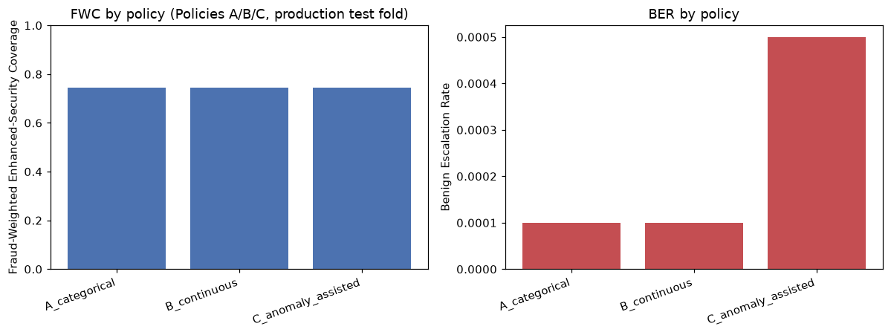
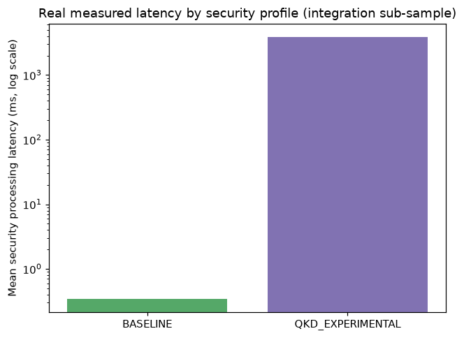
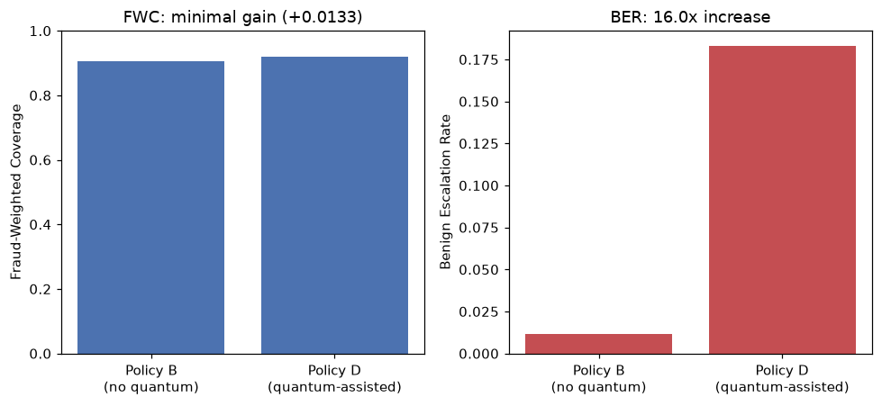

# Layer 1 -> Layer 2 Integration Experiment: Results

Executed exactly per the pre-specified `docs/protocols/LAYER2_INTEGRATION_PROTOCOL.md` (committed before this
experiment ran). All numbers below are read from `results/integration/*.csv`/`*.json`.

## Policies A, B, C (production test fold, n=55,133, 74 fraud)

| Policy | Security Escalation Rate | Fraud-Weighted Coverage | Benign Escalation Rate |
|---|---:|---:|---:|
| A: Categorical | 0.11% | **74.32%** | 0.01% |
| B: Continuous | 0.11% | **74.32%** | 0.01% |
| C: Anomaly-assisted | 0.15% | **74.32%** | 0.05% |

**Finding 1 — Categorical vs Continuous: no difference detected.** At the specific thresholds used (matched to
`config/risk.yaml`'s existing LOW/MEDIUM/HIGH boundaries, per the protocol), Policies A and B route every
transaction identically. This is an honest **null result**: on this production dataset's actual fraud-probability
distribution, the two policy families do not diverge — most true fraud cases that exceed the classification
threshold also clear the continuous escalation threshold, so collapsing to three categorical bands loses no
routing resolution here. Whether continuous routing would differ on a dataset with more borderline cases near
the LOW/MEDIUM boundary was not tested.

**Finding 2 — the anomaly signal adds cost without adding coverage.** Policy C's Fraud-Weighted Coverage is
identical to A/B (74.32% — it catches the exact same real fraud), but its Benign Escalation Rate is 5x higher.
The Isolation Forest anomaly score, at the tested threshold (>=0.8), flags additional legitimate transactions as
worth extra security without ever flagging an additional real fraud case that fraud_probability alone missed.
**This is a negative result for anomaly-assisted routing as configured, reported plainly.**

## Latency (200-row cryptographic sub-sample, per protocol)

| Profile | Mean latency | Median latency | n |
|---|---:|---:|---:|
| BASELINE | 0.34 ms | 0.13 ms | 145 |
| QKD_EXPERIMENTAL | 3886.5 ms | 3861.1 ms | 5 |

Consistent with `docs/research/layer2/LAYER2_RESULTS.md`'s standalone benchmark (~6.3s for HYBRID_MAXIMUM in that
context) — the SLH-DSA signature dominates end-to-end cost by several orders of magnitude whenever a profile
includes it. At the observed 0.1-0.11% routing rate to QKD_EXPERIMENTAL/HYBRID_MAXIMUM, this cost affects a tiny
fraction of total transaction volume, but is severe for that fraction.

## Policy D: quantum-assisted routing (separate sample: locked QML-M CONFIRM_VAL, n=250, 75 fraud)

**Never merged numerically with the Policy A/B/C table above** — different sample size, different fraud
prevalence (30% rebalanced vs 0.17% natural), different feature representation (controlled 4-feature subset vs
full 29-feature production pipeline). This is why Policy D's baseline FWC (90.67%) is far higher than A/B/C's
(74.32%) — the two samples are not comparable, and this document does not compare them.

| | Fraud-Weighted Coverage | Benign Escalation Rate |
|---|---:|---:|
| Policy B (no quantum, same sample) | 90.67% | 1.14% |
| Policy D (quantum-assisted) | 92.00% | **18.29%** |
| Delta | +1.33 pp | **+17.15 pp (16.0x)** |

31 of 250 rows changed routing between B and D; of those 31, **only 1 was actual fraud** — the other 30 were
legitimate transactions newly escalated because the classical/quantum disagreement signal exceeded the
pre-specified 0.30 threshold.

### Applying the pre-specified selection criterion

The protocol's selection criterion: *maximize FWC subject to BER not exceeding 1.5x the categorical policy's own
BER.* Policy D's BER (18.29%) is roughly **16x** Policy B's own BER on the same sample (1.14%), dramatically
exceeding the 1.5x budget for a marginal 1.33-percentage-point coverage gain (one additional fraud transaction
out of 75).

## QUANTUM AUXILIARY VALUE FOR LAYER 2: **NOT SUPPORTED**

The classical/quantum disagreement signal, as specified, does not provide a scientifically defensible routing
benefit — it fails the pre-specified cost budget by an order of magnitude for a negligible coverage gain. This
mirrors the Layer 1 finding (`docs/research/layer1/local_sum_decisive/LOCAL_SUM_DECISIVE_RESULT.md`): even
though the underlying Local-Sum QNN is a real, statistically validated architecture-level improvement over the
Global-observable QNN, it does not translate into a useful signal at the system level, here or in Layer 1's own
classical-capacity-control test.

## Best supported policy (per pre-specified criterion)

**Policy A (Categorical) or Policy B (Continuous)** — statistically indistinguishable on this data, both
achieving the same 74.32% Fraud-Weighted Coverage at the lowest measured Benign Escalation Rate (0.01%). Policy C
is rejected (adds cost, no coverage gain). Policy D is rejected (fails the cost budget by 16x for negligible
gain). Given A and B are behaviorally identical on this dataset, **Policy B (Continuous) is preferred going
forward** on the principled grounds that it preserves more information for any future threshold refinement,
even though it produced no observable difference in this specific experiment.

## Limitations of this integration experiment

- Policies A/B/C's near-identical behavior may be a property of this specific dataset's fraud-probability
  distribution (very few borderline cases) rather than a general property of categorical vs continuous routing —
  not tested on a dataset with more probability mass near the decision boundaries.
- The anomaly-escalation threshold (0.8) and quantum-disagreement threshold (0.30) were the values already
  implemented and tested in `src/security/policy/security_selector.py` prior to this experiment, not separately
  tuned for this specific ablation — a threshold sensitivity sweep (varying these values) was not performed in
  this round.
- Policy D's sample (n=250) is small; the "1 additional fraud caught" and "30 additional benign escalations"
  counts, while real and directly observed, come from a limited sample and were not independently re-confirmed
  on a second held-out sample.
